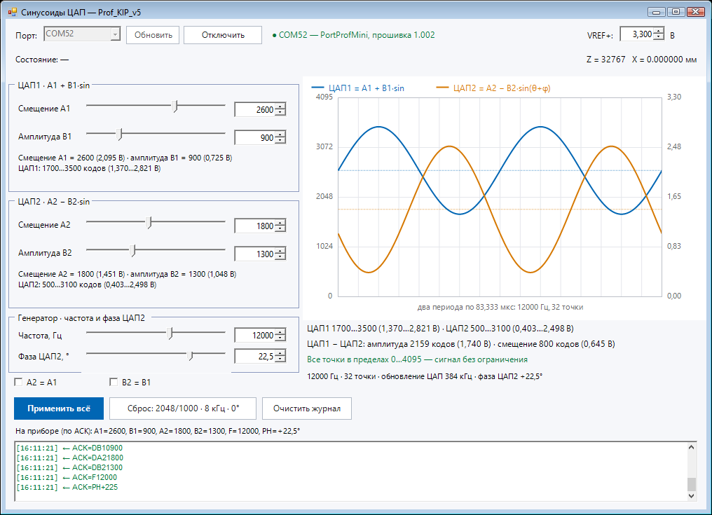

# Prof_KIP_v5 — STM32F373C8T6

Прошивка для существующего назначения ножек. HSE **8 МГц**, SYSCLK **72 МГц**, USB **48 МГц**.

## Текущая проверочная сборка

Версия 1.6. STSPIN220 и WS2812B пока не установлены, но их драйверы сохранены
и работают в прошивке: STEP, разгон, возврат и передача светодиоду.
При `BENCH_NO_MECHANICS=1` пропускается только поиск концевика и измерение люфта.
X считается по выданным STEP; без установленного драйвера это не физическое движение.
Реальный запас памяти следует оценивать по полной сборке с `-Mechanics`.

## Реализовано

- DAC1: `A1+B1·sin(θ)`, DAC2: `A2−B2·sin(θ+φ)`; 32 точки, общая частота 100…20000 Гц, фаза ЦАП2 −45…+45°.
- Оба DAC тактируются одним TIM3 TRGO. Уровни, частота и фаза задаются целями и подтягиваются в главном цикле шагами; таблицы DMA переписываются на ходу, генерация не останавливается и фаза синусоиды не сбрасывается.
- Передача таблиц и SensTrig — через DMA, без прерываний на точки синуса.
- SDADC1/PB1: непрерывный одноканальный fast mode, SDADCCLK 6 МГц, 50 000 отсчётов/с, DMA.
- Каждые 32 отсчёта: сортировка heapsort, исключение двух нижних и двух верхних, целочисленное среднее 28 оставшихся. Деление округляет к нулю.
- USB CDC: `Z=<число>,X=<мм>\r\n`, 20 Гц вне сканирования и 500 Гц в сканировании. Подтверждения ACK/ERR и сообщения STATE отправляются дополнительно. Работа начинается после инициализации; фактическая доставка возможна после USB enumeration.
- Автомат двигателя: поиск концевика, оценка компенсации, подготовка L, сканирование, автоматический возврат после CC или концевика.
- Аппаратные STEP, разгон, торможение перед рассчитанными позициями; остановка по CC/концевику без замедления, после окончания текущего импульса.
- WS2812B на LED2020/PA15: мигание 2 Гц при подготовке/возврате, плавная радуга по усреднённому SDADC в готовности и при сканировании.

## Ножки и ресурсы

| Назначение | Ножка / ресурс |
|---|---|
| DAC1 | PA4 / DAC1_OUT1 / DMA1 CH3, remap |
| DAC2 | PA6 / DAC2_OUT1 / DMA2 CH5 |
| SensTrig | PA2, GPIO BSRR / TIM3 CH1 / DMA1 CH6 |
| Точный период обновления DAC | TIM3 CH3 / DMA1 CH2 → TIM3 ARR, 32 интервала |
| SDADC | PB1 / SDADC1 channel 5 / DMA2 CH3 |
| MotorCLK | PB3 / TIM2_CH2, AF1 |
| MotorDIR | PB4 |
| MotorM1, MotorM2 | PB5, PB6 |
| MotorSTBY | PB7 |
| KONC | PF7 |
| Микросекундные интервалы | TIM5, свободный счётчик 1 МГц |
| WS2812B DIN / LED2020 | PA15 / TIM12_CH2, AF10 |
| Передача цвета WS2812B | TIM4_UP / DMA1 CH7 → TIM12 CCR2, normal, low priority |

Приоритеты CPU: STEP IRQ = 1, SDADC DMA IRQ = 2, USB IRQ = 4, SysTick = 15.
DAC и синхронизация работают аппаратно; их DMA имеют very high priority, SDADC DMA — high.

Частота задаётся 32-точечной таблицей ARR: сумма 32 интервалов равна 72 МГц / f, поэтому средняя частота точна за период. При 8 кГц это 9000 тактов (интервалы 281/282), при 20 кГц — 3600 (112/113), при 100 Гц — 720 000 (22 500). Обе синусоиды тактируются одним TIM3. Разброс соседних интервалов — один такт (13,9 нс). Абсолютная точность зависит от кварца; таблица переписывается без остановки генерации, поэтому частота меняется плавно.

Период SensTrig следует за выбранной частотой: он высокий на точках 0…15 и низкий на 16…31, переключается при обеих точках центра. DMA обновляет GPIO по событию сравнения CNT=1, связанному с тем же циклом TIM3, что и обновление DAC. Это аппаратная синхронизация с небольшой задержкой шины, а не гарантия одновременного аналогового пересечения центра: DAC и внешняя цепь имеют время установления. Начальная точка 0 также поднимает SensTrig.

## Команды COM

Полное описание форматов, координаты и подтверждений: [docs/USB_PROTOCOL.md](docs/USB_PROTOCOL.md).

Латинские ASCII, регистр верхний. Enter не требуется; CR/LF между командами допускаются. Границы USB-пакетов не являются границами команд.

| Команда | Значение |
|---|---|
| `CS` | Начать сканирование из READY |
| `CC` | Завершить только сканирование и автоматически вернуться в стартовую позицию |
| `PL001` | L = 0,1 мм |
| `PL013` | L = 1,3 мм |
| `PL320` | L = 32,0 мм |
| `PS0` … `PS8` | Выбор скорости |
| `DA1`…`DB2` + 4 цифры | Уровни ЦАП: `DA12048` — смещение A1, `DB11000` — амплитуда B1, `DA2`/`DB2` — то же для ЦАП2, коды 0…4095 |
| `F08000` | Общая частота обеих синусоид, 100…20 000 Гц |
| `PH+450` | Фаза ЦАП2 относительно ЦАП1: `PH+450` = +45,0°, `PH-045` = −4,5°, `PH+000` = 0° |
| `BT` | Приём новой прошивки через этот же COM-порт |

`PL` принимает ровно три цифры, диапазон `000`…`999` (0…99,9 мм); `PS` — ровно одну цифру 0…8; команды уровней ЦАП — ровно четыре цифры `0000`…`4095`; `F` — пять цифр `00100`…`20000`; `PH` — знак `+`/`-` и три цифры в десятых градуса `000`…`450`. `PL000` разрешён, но CS при нулевой длине возвращает ERR=CS,ZERO_LENGTH. Неоконченная команда сбрасывается после паузы более 250 мс. Неверный символ внутри команды возвращает ERR=FORMAT; новый P/C/D начинает распознавание заново. Как у любого протокола фиксированной длины, `PL1234` распознаётся как `PL123` и посторонний байт `4`.

Команды генератора меняют возбуждение датчика: **ЦАП1 = A1 + B1·sin(θ)**, **ЦАП2 = A2 − B2·sin(θ + φ)**, где φ — фаза из `PH`. Они не связаны с движением и работают даже в FAULT; допустимы уровни 0…4095, частота 100…20 000 Гц, фаза −45,0…+45,0°. Команда только задаёт цель: прибор плавно подтягивает значения (уровни около 32 кодов/мс, частота 100 Гц/мс, фаза 0,5°/мс) и переписывает таблицы DMA без остановки, поэтому синусоида не разрывается. Значения вне диапазона отклоняются с `ERR=…,RANGE`. По умолчанию A1 = A2 = 2048, B1 = B2 = 1000, F = 8000 Гц, φ = 0. Удобнее менять это окном [SineLevels.vbs](tools/SineLevels.vbs) — см. «Окно генератора».

После включения: L = **2,0 мм**, скорость **0**, частота **8 кГц**, фаза **0°**. Настройки в энергонезависимую память пока не сохраняются. CS во время подготовки/возврата получает ERR=CS,BUSY, CC вне сканирования — ERR=CC,NOT_SCANNING. Принятые команды подтверждаются ACK с повторением команды, например ACK=PL020.

PS и PL сохраняют требуемую настройку. В READY изменение PS запускает выбор нового режима, повторный поиск концевика и подготовку. Это нужно, поскольку режим STSPIN220 задаётся при выходе из standby/reset и сбрасывает электрическую фазу. Изменение PL в READY также запускает повторную подготовку через концевик, включая случай уменьшения длины.

Изменения PS/PL во время сканирования применяются после возврата по текущей трассе. Сам возврат использует длину и микрошаг подготовленной трассы; затем автомат готовит новые настройки. ACK означает принятие команды; готовность после подготовки и возврата определяется по STATE=READY. До нахождения нуля передаётся X=NA. В рабочем режиме X — счётчик микрошагов в миллиметрах, ноль при подтверждённом замыкании KONC.

## Окно генератора: уровни, частота и фаза

Амплитуды, смещения, частоту и фазу удобнее менять не командами, а небольшим окном:

```powershell
tools/SineLevels.vbs        # двойной щелчок, без окна консоли
tools/SineLevels.bat        # если .vbs не запускается
```

Окно само находит прибор по `VID_0483:PID_5740` и показывает состояние, Z и X, шесть ползунков с точными полями (A1, B1, A2, B2, частота, фаза ЦАП2), предпросмотр обеих синусоид и журнал обмена. Изменения уходят на прибор через **0,1 с** после остановки ползунка; кнопка «Применить всё» передаёт все шесть параметров сразу. Выход A±B за пределы 0…4095 выделяется красным: прошивка обрезает такие точки, и предпросмотр показывает, где именно. Частота и фаза меняются на ходу так же, как уровни: прибор подтягивает их без остановки генерации.



Прибор не сообщает текущие значения. После подключения они неизвестны, поэтому первое изменение передаёт все шесть; какие значения прибор подтвердил ACK, видно в строке «На приборе (по ACK)». **VREF+** в окне нужен только для пересчёта кодов в вольты и на прибор не передаётся. Синхронизация `A2 = A1` и `B2 = B1` необязательна и по умолчанию выключена: каналы можно настраивать независимо.

Запуск с параметрами:

```powershell
powershell -NoProfile -Sta -ExecutionPolicy Bypass -File tools\SineLevels.ps1 -Port COM52
powershell -NoProfile -Sta -ExecutionPolicy Bypass -File tools\SineLevels.ps1 -NoConnect
```

`-NoConnect` открывает окно без автоматического подключения. Файлы
[SineLevels.ps1](tools/SineLevels.ps1), [sine-levels-ui.ps1](tools/sine-levels-ui.ps1)
и [sine-levels-core.ps1](tools/sine-levels-core.ps1) должны лежать рядом. Проверки
без железа: [test_sine_levels_core.ps1](tests/test_sine_levels_core.ps1) и
[test_sine_levels_ui.ps1](tests/test_sine_levels_ui.ps1); обе входят в `tools/test.ps1`.

## Двигатель и компенсация

Расчёт: **1200 полных шагов на 8,5 мм**, внутренние координаты — 1/256 полного шага. DIR=1 выдвигает, DIR=0 задвигает.

| PS | Микрошаг | Скорость, мм/с |
|---|---|---|
| 0 | 1/256 | 0,25 |
| 1 | 1/128 | 0,5 |
| 2 | 1/64 | 1 |
| 3 | 1/32 | 2 |
| 4 | 1/16 | 4 |
| 5 | 1/8 | 8 |
| 6 | 1/4 | 16 |
| 7 | 1/2 | 32 |
| 8 | полный | 64 |

Частота STEP в установившемся сканировании около 9035 Гц для всех режимов. Реальная скорость дополнительно округляется периодом таймера. Разгон по умолчанию 20 мм/с²; короткая трасса может закончиться раньше достижения выбранной скорости. При подготовке и возврате — 1 мм/с, в выбранном режиме микрошагов. Квант перемещения при PS8 — примерно 7,08 мкм, при PS0 — 27,7 нм в расчётных координатах; механическую точность эти числа не гарантируют.

В начале двигатель находит активный KONC задвиганием. Если железка уже над датчиком, импульсы внутрь не выдаются — только подтверждается уровень. Затем двигатель движется наружу до исчезновения железки и внутрь до её повторного обнаружения. Только количество импульсов последнего короткого обратного хода принимается за компенсацию B; начальный поиск из выдвинутого положения в неё не входит. B включает **люфт и гистерезис датчика**, а также квант остановки. В подтверждённой точке обнаружения железки координата обнуляется. Двигатель выдвигается на L+B и возвращается внутрь на B, выбирая люфт в направлении будущего сканирования. После CC выполняется аналогичное позиционирование с учётом уже пройденного пути. После конца трассы на концевике координата снова обнуляется, затем выполняется возврат.

Положение рассчитывается по импульсам, обратной связи о фактическом движении двигателя нет. Пропуски шагов не обнаруживаются. Параметры ускорения, скорости и предельные ходы требуют проверки на механике.

## Настройки и диагностика

- [Core/Inc/instrument_config.h](Core/Inc/instrument_config.h): N, L по умолчанию, калибровка механики, ускорение, подтверждение KONC, ограничения поиска.
- **`BENCH_NO_MECHANICS`** (сейчас `1`): поиск нуля пропускается, текущая точка принимается за X=0, компенсация люфта 0. STEP, разгон и возврат остаются аппаратными. KONC игнорируется, сканирование ограничивается L+2 мм, после чего выполняется возврат на L. Для реальной механики поставить `0`.
- [Core/Inc/dac_sine.h](Core/Inc/dac_sine.h): независимые A1/B1/A2/B2 (коды DAC 0…4095), частота 100…20 000 Гц, фаза −45,0…+45,0°; значения по умолчанию и минимальные/максимальные границы.
- `DAC_Sine_SetLevels`, `DAC_Sine_SetFrequency`, `DAC_Sine_SetPhaseTenths` только задают цели; `DAC_Sine_Service` в главном цикле подтягивает значения шагами и переписывает таблицы DMA без остановки генерации. Из COM доступны `DA1`/`DB1`/`DA2`/`DB2`, `F`, `PH` (см. раздел «Команды COM»).
- Приветствие по USB: `HELLO_BRINGUP` в [Core/Src/instrument_app.c](Core/Src/instrument_app.c) (сейчас `1`) — один раз отправляет `Hello!` при запуске, после нового USB-подключения и при каждом открытии порта хостом (по DTR). Для чистого протокола достаточно поставить `0`.
- `acquisition_status`: последнее signed Z, число обработанных блоков, ошибки, максимальное время обработки в тактах DWT.
- `motor_status`: состояние, координата, компенсация, выбранные настройки и число ошибок.
- `instrument_usb_skipped`: пропуски запланированных передач при занятом/отключённом USB.
- `instrument_command_overruns`: нарушения предела очереди команд; при нормальном USB-потоке должен оставаться нулём.

PB1 получает готовое напряжение, соответствующее высоте. Настройки входа: single-ended zero reference, gain 1, **внешний VREF SDADC**. Z — среднее знаковых сырых кодов **−32768…32767**. Калибровку Z в физические единицы выполняет компьютер. На приборе дополнительного преобразования или демодуляции высоты нет.

**KONC — отражательный GP2S700HCP**: железка над датчиком при полном задвигании → активный низкий уровень (`KONC_ACTIVE_LEVEL=0`); железки нет → высокий уровень через внешний R35=4,7 кОм на +5 В. PF7 настроен как цифровой вход **GPIO_NOPULL**, внутренние подтяжки отключены для работы с +5 В. Подробности и проверка реальных уровней: [docs/LIMIT_SENSOR.md](docs/LIMIT_SENSOR.md). MOTOR M1/M2 предполагаются подключёнными соответственно к MODE1/MODE2 STSPIN220; STBY — к STBY/RESET. Аппаратный EN/FAULT драйвера должен быть обеспечен схемой: в данном назначении отдельного управляющего вывода для него нет.

Оптическому датчику не нужна длительная механическая задержка. Здесь при первом нужном уровне прекращаются STEP, затем уровень подтверждается в течение 100 мкс. При короткой помехе движение продолжается. Максимальный интервал обнаружения уровня определяется текущим периодом STEP, а подтверждение не добавляет движения. CC действует также во время такого подтверждения.

Начальный поиск железки и поиск освобождения ограничены ходом 40 мм, повторный короткий подход — 2 мм; сканирование при неисправном концевике ограничено L+2 мм. Есть тайм-аут каждого перемещения, рассчитанный по количеству импульсов, скорости и разгону. На ошибке двигатель выключается через STBY; восстановление — перезапуск прибора. Эти ограничения не заменяют аппаратную защиту от жёсткого упора.

## Как предотвращается переполнение

DMA SDADC циклически пишет 64 отсчёта. На каждый заполненный полубуфер процессор копирует 32 отсчёта в локальный массив, сортирует копию за O(N log N) и обновляет Z. Следующий полубуфер заполняется за **640 мкс**. Нет очереди необработанных блоков, динамического выделения памяти или ожидания USB в обработчике. STEP-прерывание короткое и имеет более высокий приоритет; USB — более низкий.

Контролируются фаза DMA, одновременное накопление HT/TC, TE, SDADC overrun и время обработки. Если срок нарушен, новые результаты не публикуются, измерение и двигатель переходят в ошибку. `max_cycles / 72` даёт максимальное время обработки в микросекундах при 72 МГц. Абсолютное «никогда» без проверки аппаратуры и предельной загрузки не заявляется: на плате требуется подтвердить запас до 46080 тактов/640 мкс, включая задержку входа в IRQ.

USB использует один буфер передачи. Если ПК медленный, устаревшая выдача пропускается; очередь телеметрии не растёт. Для очереди входных команд заранее резервируется место на целый USB-пакет; при нехватке места endpoint отвечает NAK до освобождения очереди.

ACK/ERR сохраняются в отдельной ограниченной очереди до принятия пакета USB-стеком. Если ответам нет места, выполнение новых обычных команд приостанавливается. Приём затем ограничивается NAK. Полученная CC для активного сканирования выставляет запрос остановки сразу, даже при занятой очереди ответов. Измерительные строки имеют место в пакете в первую очередь, чтобы поток команд не вытеснял расписание 20/500 Гц.

## WS2812B / LED2020

При первоначальном поиске концевика, подготовке трассы, компенсации и автоматическом возврате светодиод мигает оранжевым **2 раза в секунду**: 250 мс включён, 250 мс выключен. В READY и SCAN он показывает значение датчика. При MOTOR_FAULT горит красным.

Для индикации знаковое усреднённое значение SDADC переводится в шкалу `level = Z + 32768` с ограничением 0…65535. Поэтому нулевому входному напряжению в выбранном single-ended zero-reference режиме соответствует красный. USB по-прежнему передаёт исходный знаковый Z.

Цветовая шкала: **0 → красный → жёлтый → зелёный → голубой → синий → фиолетовый ← 65535**. Оттенок соответствует hue 0…270°. Промежуточные цвета рассчитываются с дробными компонентами Q8, без предварительного сокращения 16-битного SDADC до 8 бит. Все 65 536 уровней имеют различные расчётные цвета.

У WS2812B лишь **8 бит на канал**. Чтобы уменьшить ступени округления, прошивка распределяет дробную часть между соседними RGB-кодами во времени (temporal dithering), обновляя данные не чаще 1 кГц. За 256 кадров при постоянном входе среднее отправленных кодов точно соответствует расчётным дробным компонентам. Это не означает 65 536 статических или различимых глазом оттенков: физическая яркость зависит также от внутреннего PWM светодиода, его характеристик и восприятия. Очень малые изменения могут проявляться только в среднем по времени.

Передача — аппаратная, **GRB, MSB first**, без прерываний на биты. PA15 работает как TIM12_CH2. Свободный TIM4 запрашивает DMA1 CH7, записывающий следующее значение в preload CCR2 TIM12. Оба таймера имеют период 90 тактов при 72 МГц (800 кбит/с). TIM12 запускается немного раньше TIM4; запись DMA происходит после переноса preload, оставляя почти полный период для следующего слова. Два запуска выполняются в короткой критической секции из двух записей регистров; весь пакет не блокирует прерывания.

Длительность высокого уровня: **0 — 24 такта ≈333 нс, 1 — 62 такта ≈861 нс**. После 24 бит передаётся нулевой PWM и DIN остаётся низким. Между кадрами около 967 мкс низкого уровня при обновлении 1 кГц; после включения и при восстановлении ошибки выдерживается минимум 350 мкс reset. DMA светодиода имеет низкий приоритет и не использует каналы генерации синуса или SDADC. Если передача не завершилась или обнаружена TE, драйвер светодиода сбрасывает только свой канал и повторяет передачу после reset.

Реализация: `Core/Src/led2020.c`, расчёт и упаковка — `Core/Src/led_color.c`, параметры периодов — `Core/Inc/instrument_config.h`. В отладчике доступны `led2020_status.level`, `.frames`, `.faults`. Электрические уровни DIN нужно сверить с питанием и конкретной версией WS2812B; тайминги и цвета проверить на плате. [Даташит Worldsemi WS2812B-2020](https://www.mouser.com/pdfDocs/WS2812B-2020_V10_EN_181106150240761.pdf).

## Сборка и проверки

В STM32CubeIDE можно собирать обычным образом. Дополнительно есть автономная сборка:

```powershell
./tools/build.ps1
# Отдельная сборка для установленной механики и LED:
./tools/build.ps1 -Mechanics -OutputDirectory build/mechanics
# При другом расположении GCC:
./tools/build.ps1 -ToolchainBin 'C:/path/to/arm-gcc/bin'
./tools/test.ps1
```

Сборка создаёт `build/Prof_KIP_v5.elf`, `.hex`, `.bin`, `.map`. Флаги подобраны под размер, потому что приложение обязано укладываться в 30 КБ (раскладка обновления): `-Os` + **LTO** + отказ от таблиц раскрутки и `math-errno`. Скрипт проверяет, что копировщик лежит по адресу `0x08007800`, и останавливается с понятной ошибкой, если раскладку сбили (например, регенерацией `.ld` из CubeMX).

Скрипт тестов использует установленный MSVC (параметр `-VcVars` для другого пути) и Node.js:

```powershell
$env:PATH = '<путь к node>\bin;' + $env:PATH
./tools/test.ps1 -VcVars 'C:/Program Files (x86)/Microsoft Visual Studio/2019/Community/VC/Auxiliary/Build/vcvars64.bat'
```

Прошивальщик проверяется отдельно, без железа: подставной прибор повторяет протокол `BT → UPD READY → R****** → DONE`. Проверяются разбор `.hex`/`.bin` и отсев непригодных файлов, полоса 0–100 % без движения назад, статусы, отмена, отказ прибора (`ERR=BT,BUSY`, `ERR IMAGE`, ошибки приёма, молчание на `BT`) и подтверждение телеметрией. Дополнительно проверяется, что вывод подписок `OnLog`/`OnProgress` не попадает в разбор ответов прибора:

```powershell
powershell -NoProfile -ExecutionPolicy Bypass -File tests/test_upload_core.ps1   # ядро обмена
powershell -NoProfile -ExecutionPolicy Bypass -File tests/test_upload_ui.ps1     # окно: кнопки, статусы, отмена
```

Оба набора входят в `./tools/test.ps1`.

Скрипты в `tools` и `tests` сохранены в UTF-8 **с BOM**: Windows PowerShell 5.1 читает файл без BOM как ANSI (в русской системе CP1251) и портит кириллицу, вплоть до ошибок разбора. Проверить кодировку и синтаксис всех `.ps1`:

```powershell
powershell -NoProfile -ExecutionPolicy Bypass -File tools/_bomtest.ps1
```

**Подтяжка USB_DP на плате постоянная**, поэтому «отключение» от хоста делается только удержанием D+ (PA12) в нуле. Для обновления по COM это уже учтено и порт возвращается сам: приложение держит D+ в нуле с первой инструкции `main()` и отпускает его в `HAL_PCD_MspInit` при инициализации USB, а перед сбросом USB гасится целиком (`USBD_DeInit`). После копирования МК **перезапускается**: продолжать работу нельзя, потому что код, который это делал бы, уже перезаписан новым образом (проверено на железе — попытка «прыжка без сброса» приводила к зависанию). Проверено: порт пропадает на время обновления и появляется заново за 5–9 с (копирование + запуск + перечисление) — передёргивать кабель не нужно. После прошивки **через ST-LINK** передёргивание по-прежнему требуется: сброс делает программатор, и МК не успевает показать отключение.

## Обновление ПО по USB (без ST-LINK)

Прошивка обновляется **через тот же COM-порт**: ни программатор, ни драйверы DFU, ни утилиты ST не нужны.

### Прошивальщик с окном

Двойной щелчок по [tools/FirmwareUploader.bat](tools/FirmwareUploader.bat) открывает окно прошивальщика; сам `.bat` сразу закрывается, поэтому на экране остаётся только окно программы:

- **«Обзор…»** — выбрать, какую прошивку залить: `.hex` или `.bin` из файловой системы; последний файл запоминается;
- **«Порт»** — COM-порт прибора; заполняется сам по `VID_0483:PID_5740` (через PnP, при недоступности — через WMI, затем через реестр: `SERIALCOMM` + `Enum\USB`), кнопка «Обновить» перечитывает список;
- **«Залить прошивку»** — полоса загрузки 0–100 % и текущий этап с подробностями: проверка файла, поиск прибора, открытие порта, `BT` (стирание области загрузки), передача (строки и счётчик прибора), установка `GO`, перезапуск и проверка телеметрии;
- **«Отменить»** — та же кнопка во время работы: заливка прерывается, прибор выходит из режима загрузки сам по 30-секундному тайм-ауту;
- **журнал** — обмен с прибором построчно (`ACK=BT`, `R******`, `DONE`, `Hello! fw 1.6`, телеметрия) с отметками времени.

Цвет статуса и полосы показывает исход: синий — идёт работа, зелёный — готово, красный — ошибка, жёлтый — отмена.

Файл можно перетащить прямо на `.bat` (или `.vbs`) — он подставится в поле и проверится.

Три варианта запуска, если ярлык не нужен:

| Файл | Поведение |
|---|---|
| [FirmwareUploader.bat](tools/FirmwareUploader.bat) | обычный запуск с двойного щелчка: `powershell.exe` стартует скрытно, консоль закрывается сразу |
| [FirmwareUploader.vbs](tools/FirmwareUploader.vbs) | то же без мелькания консоли (если `.vbs` не блокирует антивирус) |
| [FirmwareUploader.cmd](tools/FirmwareUploader.cmd) | запуск с видимой консолью: текст ошибок PowerShell остаётся на экране — для диагностики |

Все три запускают один и тот же [FirmwareUploader.ps1](tools/FirmwareUploader.ps1). Его же можно вызвать вручную:

```powershell
powershell -NoProfile -STA -ExecutionPolicy Bypass -File tools/FirmwareUploader.ps1 -Firmware build/Prof_KIP_v5.hex
```

**Файл проверяется до отправки** — теми же правилами, что применяет приёмник на приборе: контрольные суммы записей Intel HEX, наличие записи конца файла, правдоподобность таблицы векторов (стек в RAM, вектор сброса внутри приложения и с Thumb-битом), попадание данных в 30 КБ и пропуск записей копировщика. Поэтому непригодный файл отвергается до команды `BT`, а не после передачи всего файла. `.bin` из `build` содержит ещё и копировщик, лежащий за 30 КБ: заливаются первые 30 КБ, о чём сообщается в журнале.

Признак успеха — прибор снова отдаёт телеметрию (`Z=…`): после `DONE` прошивальщик сам выдерживает паузу, снова открывает **тот же** порт (номер у прибора не меняется) и читает поток. Кэш диспетчера устройств сразу после переподключения прибора бывает пустым, хотя порт уже работает, поэтому проверка не опирается на `SERIALCOMM`: если известный порт не открылся, дополнительно ищется порт по `VID/PID`. Если образ принят (`DONE`), но телеметрия не появилась, заливка считается выполненной, а запуск — неподтверждённым.

**Проверено на реальной плате** (STM32F373C8T6, USB-подключение, fw 1.6): заливки подряд, каждая 5,0–5,8 с от нажатия кнопки до строки «Готово» — передача 1496 записей занимает около 2 с, порт снова открывается примерно через 4 с после `DONE`, затем подтверждается телеметрия и версия (`Hello! fw 1.6`). Передёргивать USB-кабель не требуется. Тот же результат даёт `.bin` (`build/Prof_KIP_v5.bin`: 1920 записей по 30 КБ, 5,4 с) и консольный `upload-com.ps1` (5,2 с).

Если прибор после обновления всё же не отвечает: проверьте, не занят ли COM-порт другой программой (терминал, монитор порта) — прошивальщик сообщает об этом ошибкой открытия; затем отключите и подключите USB-кабель, чтобы прибор стартовал с чистого состояния. Восстановление при испорченном образе — ST-LINK (SWD) или `BOOT0` в высоком уровне при включении (заводской DFU), см. «Ограничения и оговорки» ниже.

### Консольная версия

```powershell
./tools/upload-com.ps1 -File build/Prof_KIP_v5.hex
# скрипт сам: отправляет BT, передаёт .hex, шлёт GO и проверяет, что прибор ожил
```

Окно и консольный скрипт работают через один модуль [tools/upload-core.ps1](tools/upload-core.ps1): проверка файла, обмен, тайм-ауты и тексты статусов у них общие.

Что происходит: команда `BT` переводит прибор в режим загрузки (синус стоп, стирается временная область), файл `.hex` построчно пишется в неё, `GO` заставляет прибор посчитать контрольную сумму, записать маркер в RAM, разорвать USB (D+ в нуле) и перезапуститься; при старте `Firmware_BootCheck()` вызывает копировщик `.copyer`, тот проверяет сумму и переносит новое ПО на место приложения, после чего МК перезапускается уже с новой версией. Протокол обмена описан в [docs/USB_PROTOCOL.md](docs/USB_PROTOCOL.md).

**Раскладка флеша** (страница 2 КБ, всего 32 страницы; задана в [STM32F373C8TX_FLASH.ld](STM32F373C8TX_FLASH.ld)):

| Область | Адрес | Размер | Назначение |
|---|---|---|---|
| Приложение | `0x08000000` | 30 КБ (страницы 0…14) | основная прошивка |
| Копировщик | `0x08007800` | 2 КБ (страница 15) | переносит новое ПО; **не перезаписывается** обновлением |
| Загрузка | `0x08008000` | 32 КБ (страницы 16…31) | сюда принимается новый `.hex` |

Ограничения и оговорки:
- **приложение должно оставаться ≤ 30 КБ** — это проверяет и линкер, и `tools/build.ps1`;
- правки в `.ld` и в регионах памяти **обязательны для схемы обновления**: если перегенерировать проект из CubeMX, файл вернётся к 64 КБ и `build.ps1` остановится с ошибкой про копировщик;
- копировщик обновлением не обновляется (он лежит вне зоны копирования) — меняется только через ST-LINK/DFU;
- питание нельзя терять в момент копирования (~1 с): тогда приложение останется частично записанным, и восстановление потребует ST-LINK (SWD) или BOOT0→DFU;
- если обновление прервалось (тайм-аут, разрыв USB) — прибор сам вернётся в рабочее состояние, повторяйте `upload-com.ps1`;
- аварийные пути на случай «прошивка не отвечает»: ST-LINK (SWD) или **BOOT0 в высокий уровень на момент включения** (на плате он подтянут конденсатором C36, перемычки нет) — включится заводской загрузчик, но для него на этом ПК нужен драйвер WinUSB вместо STTub30.

Тесты исполняют реальные C-модули фильтра, протокола и автомата двигателя с моделью регистров: 10 000 наборов фильтра, крайние signed коды, команды без разделителей, тайм-ауты, поиск концевика, возврат после CC, ложный уровень, CC во время подтверждения уровня, смена микрошагов, ошибка и длительная PL999/PS0. Отдельная модель проверяет 128-точечную таблицу синуса, pipeline DAC, 32 интервала TIM3, частоты 100/1000/8000/20000 Гц и фазовую интерполяцию.

Для LED проверяются все 65 536 значений градиента, его непрерывность с шагом входа 1, края signed/unsigned шкалы, среднее temporal dithering за 256 кадров, мигание 2 Гц, порядок GRB, границы длительностей WS2812B-2020 и модель preload PWM/DMA.

Тесты нового USB-протокола исполняют настоящий модуль instrument_app.c с моделью USB: ACK/ERR, все девять микрошагов, пересчёт и округление X, X=NA до нуля, сохранность занятого TX-буфера, заполнение/освобождение очередей без потери ACK, выдача 500 Гц, немедленная обработка полученной CC при занятой очереди ответов и новое USB-подключение.

Настройка дополнительных таймеров/DMA выполняется в пользовательских модулях при запуске; `.ioc` не отображает всю эту конфигурацию. Fast mode SDADC и приоритет USB отражены также в `.ioc`.

**На реальной плате прошивка не запускалась.** Перед рабочим сканированием проверить осциллографом DAC/SensTrig/STEP, полярность и уровни KONC, VREF, соответствие MODE1/MODE2, направление, разгон и счётчики ошибок при 500 Гц USB. Испытания на ПК не подтверждают электрическую схему и механическую калибровку.

Документация ST: [RM0313](https://www.st.com/resource/en/reference_manual/rm0313-stm32f37xxx-advanced-armbased-32bit-mcus-stmicroelectronics.pdf), [AN4207 SDADC](https://www.st.com/resource/en/application_note/an4207-getting-started-with-stm32f3738xxx-sdadc-sigmadelta-adc-stmicroelectronics.pdf), [STSPIN220](https://www.st.com/resource/en/datasheet/stspin220.pdf).

## Проверка версии 1.6 и размер

Размер приложения без отдельного копировщика (260 байт):

| Сборка | Flash приложения | Инициализированные данные + BSS |
|---|---:|---:|
| До оптимизации, проверочная | 25 904 байта | 9 144 байта |
| После оптимизации, проверочная | 23 872 байта | 6 880 байт |
| После оптимизации, полная механика и LED | 23 932 байта | 6 880 байт |

Экономия текущей сборки: 2 032 байта Flash и 2 264 байта статической RAM.
Полный вариант оставляет 6 788 байт из выделенных приложению 30 720 байт.
Стек и куча в последнем столбце не учтены.

Мотор и LED не исключались из итоговой проверочной сборки. Основная экономия —
вывод ASCII целых чисел вместо универсального printf и USB-буферы по 64 байта,
соответствующие одному Full Speed пакету, вместо двух буферов по 1024 байта.
Разбор команд, ACK/ERR, контроль DMA/SDADC, границы массивов и проверка прошивки
сохранены. Из загрузчика убран произвольный порог числа HEX-строк: вместо него
требуется корректная запись конца файла, данные и допустимые векторы запуска.

Обе ARM-сборки и компьютерные тесты прошли. Тесты охватывают механику,
концевик, фильтр, градиент LED, очередь USB, 500 Гц, отмену команд после BT,
проверку HEX и точность/границы компактного вывода ASCII. Прошивка на плату
в ходе этих изменений не загружалась.

Папки `_akt_pismo`, `tray_prank`, артефакты `Debug` и `build`, а также
компьютерные тесты в микроконтроллерную программу не входят. Их удаление
не уменьшит Flash; посторонние пользовательские файлы оставлены на месте.
Неиспользуемые функции HAL уже удаляются линкером; USE_FULL_ASSERT выключен.
## Ручной тест шаговика по концевику

Сборка `tools/build.ps1 -LimitJog -OutputDirectory build/limit-jog` включает
отдельный MOTOR_LIMIT_JOG=1 (в обычной сборке он выключен).
После настройки STSPIN220 движение запускается автоматически:
PF7 HIGH / зелёный → DIR=0, PF7 LOW / красный → DIR=1.
Реальный концевик читается и при BENCH_NO_MECHANICS=1.
На смене уровня STEP останавливается, подтверждается уровень KONC_CONFIRM_US,
затем запускается обратное направление с разгоном. По прямому запросу пользователя
в этом тесте нет ограничений длины/времени сегмента; условная координата не накапливается.
Команда CC останавливает движение, Motor_Fault выключает драйвер.
USB-загрузка тестовой сборки принята, но первый перезапуск не подтвердился:
необходимо проверить плату через ST-Link, не считать запуск двигателя проверенным.
Тестовая сборка восстановлена через ST-Link: запись с верификацией успешна,
COM6 вернулся, MotorStatus.state=MOTOR_SCAN, faults=0, TIM2 выдаёт STEP ~9 кГц.
Исправлен Firmware_CopyStub: успешное копирование очищает маркер и делает
сброс непосредственно из защищённой секции .copyer, не возвращаясь в заменённый APP.
Физическое вращение и обе полярности переключения требуют наблюдения пользователя.

EN/FAULT драйвера подключён к PB9 (вывод 46), STBY/RESET — PB7. Добавлены EXTI по спаду и защёлкивание аппаратной аварии. В сборке TravelCal мотор после включения теперь ждёт CS и не стартует сам. Подробности: docs/MOTOR_CALIBRATION.md.


## Только индикация концевика, без двигателя

Сборка: tools/build.ps1 -LedOnly -OutputDirectory build/led-only.
MOTOR_DISABLED=1: STEP не запускается, STBY/RESET удерживается LOW,
команда CS не может включить движение. LED показывает сырой PF7:
LOW (концевик активен) — красный; HIGH — зелёный. Яркость прежняя.
28.10.2026 эта сборка успешно загружена через USB COM6 за 5,4 с,
после самостоятельного перезапуска вернулась телеметрия.

## Текущий рабочий прогон двигателя

Сборка: `tools/build.ps1 -ShuttleTest -OutputDirectory build/shuttle-10mm`.
После включения один цикл: выдвижение 10 мм (DIR=1), задвижение 10 мм (DIR=0),
затем отключение обмоток. Повтор — командой CS; остановка — CC.
Принятый пользователем максимум текущей механики: около 29 мм/с по калибровке,
микрошаг 1/64, множитель ускорения 4. Полные параметры:
`calibration/motor-max-working.json`; результаты проверок: `docs/MOTOR_CALIBRATION.md`.
При USB-обновлении LED мигает зелёным на 50% яркости.

Музыкальная проба сохранена отдельно: `tools/build.ps1 -MusicTest -OutputDirectory build/music-test`.
Она сейчас не загружена; описание — `docs/MOTOR_MUSIC.md`.
